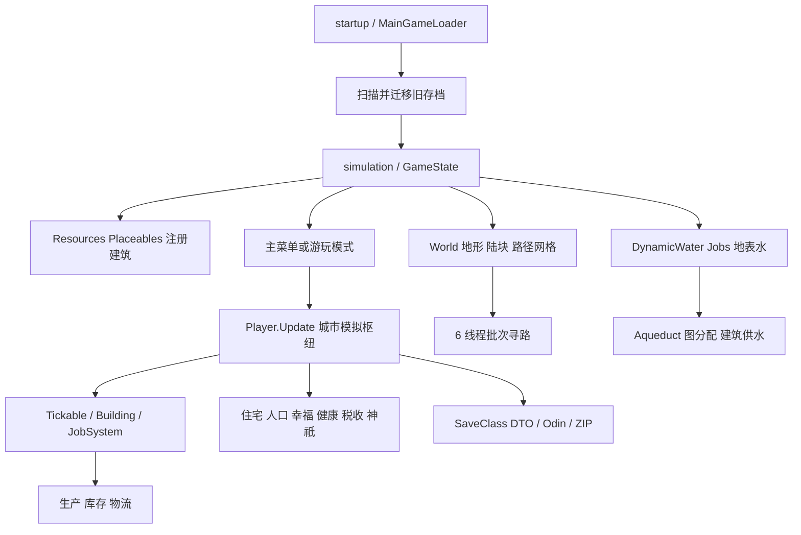

# Nova Roma 发行构建全面分析

本地目标：`D:\SteamLibrary\steamapps\common\Nova Roma`。结论绑定本次读取的 **0.7.2963 / Main / Release** 构建，构建文件记载时间为 **2026-10-15 10:20:24**，没有提供该时间的时区。本次分析日期为 **2026-10-18（中国标准时间）**。

这是一个 **Unity 6、Windows x64、Mono 托管代码的城市建造游戏发行目录**，不是含 Assets/ProjectSettings/Packages 的开发源码工程。主体架构是管理器 + 普通 C# 模拟对象 + 建筑组件 + 自定义格网；地表水等重计算使用 Burst/Jobs，居民绘制使用批实例化。并不能因交付 Unity.Entities 就把整个游戏称为 ECS 工程。

分析已覆盖发行身份、资源组织、启动与城市模拟、人口经济、物流贸易、神祇任务、水利、寻路绘制、存档迁移、Mod 与联网边界。采用完整文件清单、程序集元数据、本地反编译、Unity 资源解析、关键场景组件及纯算法隔离执行进行交叉核对；没有启动游戏、访问游戏后端、迁移玩家数据或修改游戏安装目录。这里的“全面”指主要子系统覆盖，不表示逐一审计全部 19,365 个主程序集方法或复现全部玩法。

## 阅读入口

| 文档 | 内容 |
|---|---|
| [城市模拟与经济](simulation-analysis.md) | 更新链、建筑生命周期、人口住宅、幸福税收、生产、物流、贸易、神祇任务、补充玩法覆盖表 |
| [水利、寻路与渲染](water-pathing-rendering-analysis.md) | 地表水公式、渡槽优先分配、取水/水塔/澡堂/排水口、线程寻路、实例绘制 |
| [存档、Mod 与联网](persistence-mods-analysis.md) | ZIP/Odin 格式、自动旧档迁移、存储完整性、扩展启用状态、Steam/EOS/Twitch/分享边界 |
| [资源与发行结构](assets-analysis.md) | 安装文件、引擎版本、Unity 容器、场景、FMOD、原生依赖、资源解析范围 |
| [证据与复核记录](verification.md) | REA 证据编号、命令、工具、最低充分验证与未决问题 |

## 1. 构建规模与可分析程度

| 项目 | 已观察结果 | 证据 |
|---|---|---|
| 安装内容 | 313 个文件，共 970,352,298 bytes，约 925.4 MiB | `file-inventory.csv` / `file-inventory-summary.json` |
| 引擎 | Unity `6000.2.10f1` | 序列化文件头与 UnityPlayer 版本交叉核对 |
| 平台 | NovaRoma.exe 和 UnityPlayer 为 x64；托管核心为 AnyCPU CIL；EOSBootstrapper 为 x86 | `native-dependencies.json`；REA 元数据 |
| 主代码 | Assembly-CSharp.dll 4,246,528 bytes；2,620 TypeDef、19,365 MethodDef、20,190 Field | REA 主程序集完整元数据 |
| 基础/第三方代码 | Assembly-CSharp-firstpass.dll：1,410 TypeDef、10,004 MethodDef | REA firstpass 元数据 |
| 独立水网核心 | Roma.Aqueduct.dll：7 TypeDef、38 MethodDef，仅引用 netstandard | REA 水网程序集元数据 |
| 反编译产物 | main 1,320 个 C# 文件、307,639 行；firstpass 949 个、117,081 行；aqueduct 3 个、689 行 | `code-index.json`，包含生成代码/第三方代码，不能当作原作者代码量 |
| 资源目录 | 已读容器合计 137,422 个对象记录；824 Mesh、779 Texture2D、156 AnimationClip、62 AudioClip | `unity-asset-summary.json`；是静态包内对象数，不是同时加载/可见数量 |
| 场景 | `startup` → `simulation`，包含主菜单和模拟对象 | BuildSettings + MainGameLoader + 场景组件图 |

主程序集 SHA-256 为 `9278fdc22d8b48f5082385e91b9495eb00df2116662dbf199d7b66a2d7f11fc1`，MVID 为 `b9d28051-2fde-40fd-9bfc-17b7c94c4e63`。托管 DLL 的 PE32/x86 标头不意味着游戏只能运行在 32 位：CLI il-only 且不要求 32 位，REA 将其分类为 AnyCPU，宿主是 x64。

大多数业务类、字段和方法具有可读语义名称，CIL 与元数据可读；本次没有遇到必须先解密/脱壳才能分析主逻辑的障碍。但反编译不是恢复原始工程：没有原始注释、版本历史、Unity 编辑器配置和完整资源源文件，也未证明生成的 csproj 可重新编译并重建原游戏。

## 2. 实际架构与执行链

`Player.Update` 是模拟推进的主要入口；`World.Update` 更侧重地形、路径网格维护和寻路线程同步。游戏把地理陆块与政治所有者分开：所有者可持有多个陆块，实物资源/仓储和居民按陆块处理，金币进入所有者财政。建筑组件通过建成事件登记资源提供、岗位与路径变化。

这是大量相互引用的管理器与静态单例协作的结构。其优势是迭代直接，资源/建筑/任务共享一套世界状态；代价是存档恢复顺序、场景加载、暂停状态和扩展代码都依赖生命周期约定。该判断来自 `MainGameLoader`、`GameState`、`Player`、`World`、`LoadSaveContainer` 的实际调用链，不是仅根据文件命名分类。

## 3. 城市玩法的关键反馈

**人口增长取决于“每户拿到什么”，而不是只看城市总库存。** 住宅保存食物库存并按饮食多样性计算幸福，家务岗位会占用居民劳力，饥饿、尸体、无家人口和税负压低幸福；当前幸福再缓慢追向目标值。移民船按幸福、全体人口规模、目的地空房及袭击状态结算。扩张会同时提高产业用工、住宅消费和宗教维护要求。

**生产有多重门槛。** 通用加工建筑要求开放、工时、分配工人、工人到岗比例、输入材料和输出容量；农业改用季节累计与秋收。道路/寻路与物流在实物到达中起作用，库存不是统一瞬移池。

**税收是税务覆盖与人员配置共同决定的。** 有效税率取覆盖税务所的税率×人员比例的最大值，房屋按入住比例计税，同时税率带来幸福惩罚。重叠税务所不直接按覆盖数量叠税。

**神祇任务具备状态与资源后果。** 人口/建筑/献祭任务、完成对话、升级解锁、怒气档次、节庆成本和雷击/火灾/作物/疾病/加水惩罚存在具体实现。任务“进度达到 1”只使完成提示可见，不能跳过对话交付步骤。任务与奖励的最终 UI/对话回调仍有资源侧未决项。

精确公式与源码位置见城市模拟分报告；其中的代码默认值均需要与 Prefab/ScriptableObject 序列化值区分，不能直接拼成可靠的全建筑产能攻略。

资源对象已解析出21项内部资源：wheat、tree、stone、charcoal、gold、iron、tools、armaments、fish、apples、ham、bread、grapes、wine、marble、clay、pottery、dirt、olives、oliveoil、salt，ID映射与携带量等标量见 `resource-definition-summary.json`。实际四季定义时长为春100、夏125、秋100、冬125，总计450模拟时间单位；倍速档为0/0.85/1.2/2/10。暂停、第一年特殊推进和缩放会改变墙钟耗时，不能把450直接换成固定现实秒数。

## 4. 水利是本构建的独立技术核心

地表水在细分网格计算地形/阻挡/水深差导致的四方向通量，再更新水深、新鲜度、蒸发、水源和抽取。渡槽则把建成管线转成有向图，按照消费优先级、距离、需求和最低门槛分配供水。取水口将两层连接；排水口还能把管网水量重新注回地表。

场景 `level1:33636` 的 DynamicWater 已严格按交付程序集 schema 读取：调度间隔=0.1，积分步长=0.1，Gravity=10，Evaporation=0.005，job batch=64。它覆盖了反编译字段默认的 TimeStep=0.25 / Gravity=9.81 / Evaporation=0.1，说明单读 C# 默认值会得出错误平衡参数。场景水格宽高保存为 351×351；地图初始化还会重新按世界尺寸分配，不能据此给整个游戏设定固定地图上限。

渡槽不是平均分水。隔离运行交付的纯求解器 DLL，4 个用例全部通过：源 10、同级需求 8/8 实际分配 8/2；提高第二需求优先级后变 2/8；不足最低服务量会回退本轮供给；边容量会限制抽水和交付。详细输入/输出在 [solver-cases.json](solver-cases.json)。实验没有启动 Unity，因此也没有证明完整地图的运行表现。

## 5. 存档与兼容机制

常规存档为 ZIP：`world`、`summary`、封面图和可选旗帜。world/summary 前导字节 `4F`，后接 Odin Binary。各系统先打包为 SaveClass DTO，再写文件；加载按排队 Action 恢复世界与各子系统。设置同样使用 Odin，不是人可直接改的 JSON。

启动时自动扫描旧档并执行 BinaryFormatter→Odin 迁移，迁移完成后才加载模拟场景。普通加载拒绝旧格式与“启动时仍会运行旧格式迁移”同时成立，二者并不矛盾。

Windows 默认持久化路径候选由 PlayerSettings 的 LionShield/Nova Roma 与 persistentDataPath 推导；当前账号该精确目录不存在，本次没有读取或验证玩家存档。所有格式与风险结论来自代码/打包内容，而非假造一个真实玩家存档测试。

## 6. Mod、网络和遗留代码的界限

| 项目 | 结论 | 证据强度/限制 |
|---|---|---|
| 源码 C# Mod | 有运行时编译器及 KCModHelper API，当前构建未建立启用链 | bootstrapper 空；关键生命周期只有定义；扫描场景未找到 ModLoader 挂载。不能保证放入 mods 就会加载 |
| Workshop | 存在旗帜与旧 kcmod/游戏 UI 多种流 | 部分查询保留 1199380/569480 和 kcmod 常量；GameWorkshopUI 场景默认 inactive。不能合并为“官方已启用全部 Mod” |
| Steam | 有实际平台初始化、回调、成就与 DLC 调用 | 未运行 SteamAPI 核对成功状态 |
| EOS | 随包 SDK/Bootstrapper/配置 | 不足以证明跨平台联机或实际建立联网会话 |
| Twitch | IRC/投票代码与场景组件存在，可由设置激活 | VotingFeature 祖先默认 inactive；是聊天互动，不是城市多人同步 |
| 存档分享 | HTTP 分享 API 与 UI 调用链存在 | 未访问服务、验证活性或执行上传 |
| 城市多人 | 在主游戏逻辑扫描中未建立证据 | 未见房间、主从状态同步或 RPC 链；这不等于所有第三方 DLL 都绝无联网 |

大量旧王国/战争/Workshop 命名和实现保留，是分析时的重要约束：类存在、资源存在、场景挂载、运行中启用、玩家可达应逐层核对。分报告对军团、外交、战车赛、怪物和灾害分别标注覆盖，避免把残留类当成当前玩法保证。

## 7. 工程风险与可修改边界

下面排序依据实际数据完整性和代码机制，不是已经发生问题的严重度排名。

| 关注项 | 已观察机制 | 本次结论 |
|---|---|---|
| 自动存档失去上一份 | 新状态收集/压缩完成前先清同世界旧自动档 | 有明确失败窗口，未在玩家数据复现 |
| 常规 ZIP 保存失败 | 现有目标先删除；world 写线程错误未作为 finalize 失败状态传递 | 不是原子替换，不保证保留旧档/完整 world |
| 迁移恢复 | 备份清理主要依赖首字节等浅检查；失败也写已处理清单 | 部分中断/失败组合不会自动重试或完整验证 |
| 寻路与水模拟开销 | 6 线程批次等待、A* openSet 线性扫描、Complete 与纹理/数组拷贝 | 有性能调查入口，尚无 profiler 证据认定热点 |
| 渡槽争水 | 顺序承诺、优先级和最低门槛，需求 dirty 也整图重建 | 非平均分配；大网开销与振荡未测 |
| 经济数值分支 | 有效税率连续值与分档判断、自动贸易统计/船舱扣除存在不一致线索 | 候选缺陷，尚未运行复现，不等同于已确认漏洞 |
| 构建内服务配置 | 包含认证/密钥命名字段及保留服务请求头 | 只记录存在/脱敏元数据，未验证有效性或服务权限 |

如果后续目标是修改玩法，优先定位业务方法和其对应序列化参数：人口经济看 Player/Home/YieldProducer/JobSystem；水网算法看独立 Roma.Aqueduct；地表水看 DynamicWater 的 Burst Jobs；建筑成本/配方/季节看资源对象；存档工具必须匹配 Odin 类型图和当前程序集身份。仅替换 DLL、编辑字节或安装外部 loader 都不在本次分析操作内。

## 8. 覆盖与剩余不确定性

| 原始分析问题 | 状态 |
|---|---|
| 目标身份、引擎、架构、文件和依赖 | 已回答，完整安装文件 SHA-256 清单 |
| 主模拟、人口、经济、物流、税收 | 主要机制已回答；完整建筑/配方平衡表未穷举 |
| 地表水、渡槽、建筑供水 | 代码与关键场景值已回答；4 个纯算法用例已执行 |
| 寻路、居民绘制与优化结构 | 已回答主要机制；真实性能未测 |
| 神祇/任务/其他玩法 | 代码级主要路径已检查；资源回调、可达性及平衡保留部分未知 |
| 存档、设置、旧档迁移 | 静态格式与数据流已回答；无真实玩家档恢复验证 |
| Mod/Workshop/联网 | 代码与关键默认场景启用状态已核对；外部服务及动态反射未运行验证 |
| 安全/全部原生 DLL/完整审计 | 未作为逐函数安全审计完成，不给全局安全保证 |
| 源工程恢复 | 有可浏览反编译文本；未恢复可编辑/可构建的完整 Unity 项目 |

交付包括本报告、4 份专题、文件/资源/组件/代码索引、REA 原始证据包和算法结果。分析脚本与反编译副本保存在工作区，纳入本地 Git；没有将约 925 MiB 游戏原目录复制进 Git。既有文件未删除，体积大的中间证据保留在 work 目录。
