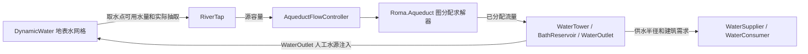

# 水利、寻路与渲染分析

本报告绑定本机 `D:\SteamLibrary\steamapps\common\Nova Roma`，版本 0.7.2963。代码位置均相对本工作区 `work/decompiled/`；行号指 ILSpy 重建 C#，不代表开发者原始源码。静态代码、场景数据、隔离算法实验分别陈述。

## 1. 两套水系统怎样连接

这不是仅靠着色器制造的河流效果：网格持久化水量、四方向通量和 freshness，计算结果影响取水、水塔、澡堂和淹水反馈。也不是一套完整管道压力方程：渡槽核心输入是有向图、源容量、边容量和需求，几何坡度由放置验证层处理。

证据：`main/DynamicWater.cs:17` 的 WaterCell；`main/RiverTap.cs:626`、`:630`、`:683`；`main/AqueductFlowController.cs:213`；`main/WaterOutlet.cs:250`。场景存在性/启用状态见 `target-component-evidence.json`。

## 2. 地表水数值模型

`DynamicWater.Init` 在世界网格 W×H 上分配 `(2W+1)×(2H+1)` 水网格（`main/DynamicWater.cs:1622`），并分配水格双缓冲、地形高度、阻挡高度、瀑布列表、简化世界格水深、流速与纹理。尺寸因此随地图面积增加；多个同尺寸数组构成主要常驻开销。

每步核心次序（`StepSimulationN`，`:2622`）是：

1. `UpdateFluxParallelJob`：由相邻格水面高度差更新出流。
2. `UpdateWaterHeightParallelJob`：由流入、流出和蒸发更新水深与 freshness。
3. `AddWaterParallelJob`：增加水源供水；自然水源乘天气/季节系数，人工水源分支使用 1。
4. 按请求执行 `ExtractWaterJob`，再汇总水量。
5. 后处理更新纹理、简化网格、瀑布与地形变化；主线程回调抽水请求。

对第 i 格与邻格 j，重命名反编译临时变量后，通量更新为：

`q_ij = 0.995 × max(0, q_old + dt × A × g × ((terrain_i + obstruction_i + h_i − terrain_j − obstruction_j − h_j) × TerrainExaggeration) / L)`。

再以 `K = min(1, h_i × L² / (sum(q) × dt))` 统一缩放该格出流，限制其流出的水量。水深用 `h_next = max(0, h + dt × (sum_in − sum_out) / L² − evaporation_term)` 更新。证据 `main/DynamicWater.cs:202`、`:243`、`:259`、`:310`、`:351`、`:377`。这是由静态实现归纳的离散模型；未测量游戏运行时守恒误差或数值稳定域。

freshness 由上游混合、邻格扩散、衰减和流动更新；它降低蒸发。`sum_in + sum_out > 0.1` 时直接设为 1（`:368` 附近），所以该字段应理解为游戏的水体新鲜度/蒸发控制量，不能直接当作现实饮水卫生或污染浓度。

`LateUpdate` 在主线程 `Complete()` 上批任务，然后上传纹理、复制 NativeArray、更新地形重烘焙列表（`:2097`）。这说明使用 Burst/Jobs 并不等于水系统完全脱离主线程。`SimulationTimeStep` 控制调度次数，`TimeStep` 作为每次数值积分 dt；代码字段默认分别 0.1 和 0.25，但严格解析 `level1:33636` 场景对象后，两者序列化值均为 **0.1**，Gravity=10、Evaporation=0.005、A=L=1、jobInnerloopBatches=64（见 `focus-serialized-fields.json`）。这些是交付场景初始值，运行中的地图加载仍可改变状态。每帧计算次数截为最多 4；扣除时间积累发生在截断之前（`:2230`、`:2243`），长帧期间不会保留全部未执行积压。此为代码行为，不是已经实测的帧率故障。

淹树机制也有直接代码：累积 `(水深 − 最低深度) × dt × 曝露倍率`，超过门槛处理树木（`ProcessTreeFloodDamage`，`:2472`）；默认字段最低深度 0.05、阈值 1.5，但场景可覆盖。建筑伤害需结合 Building 更新链，不能把水覆盖 UI 标色直接等同于建筑已经被摧毁。

## 3. 渡槽图分配算法

独立程序集 `Roma.Aqueduct.dll` 只引用 netstandard；SHA-256：`09efb91699b31eb3d07737f6f176ac2302217a727e104fc98efac82f02e1e485`。REA 元数据证据 `ev_0ba21d291d2fce70935a4fac922da7736da173b63c6561e01e44dad578a0c42e`；成员证据 `ev_7cb1bf6cf258044cf3ece0689b940d6d80aad9ace1f514199d8d74bc41d80fc2` 为 partial，不能称所有成员 IL 已完整覆盖。

`aqueduct/Roma.Aqueduct/AqueductFlowSolver.cs` 的算法：

- 源/汇各用一个超级节点，网络边保存正反向边及剩余容量。
- `ComputeConsumerOrder` / `CompareConsumers` 对消费者排序；passthrough 优先，其内部先比较距源 BFS 深度，再比较优先级；普通消费者先比较优先级（数值大者先），然后 BFS 深度；再按需求从大到小、节点编号从小到大决胜。
- `RunMaxFlow` 逐个开放消费者的汇边，通过 BFS 增广求本轮流量；成功后把该轮正向边流量加到 committed，后续消费者不能撤回前面已承诺的供水。
- 本轮供水小于 minServe 时撤回本消费者的本轮流量；这是门槛式分配，而非自动等比例平分。
- `SolveWithConduitDetection(maxRounds=4)` 识别供水不足但仍有网络出流的中转消费者，标记 passthrough 后重新求解，最多附加 4 轮。

因此可准确描述为“按消费者顺序承诺流量的 BFS 增广分配器”。不把它称为任意网络上的全局公平、总供水最优或连续流体压力求解器。

`AqueductFlowDriver.LateUpdate` 调用控制器；仅 topologyDirty 或 demandDirty 时且未处于加载过程才求解（`main/AqueductFlowDriver.cs:20`；`AqueductFlowController.cs:146`）。但两种 dirty 都走 `Rebuild`，不是仅在拓扑改变时才建图。仅 fullyConstructed 且非 displayOnly 的渡槽边进入图；普通边容量使用 `AqueductBuilding.MAX_WATER_FLOW_HUMAN_UNITS = 250`（控制器 `:225`、`:243`；建筑 `:46`）。

`RiverTap` 的物理取水容量来自地表水，网络需求再约束下一批 perStepBudget（`main/RiverTap.cs:630`）；水量单位换算为 `250 human = 0.07 system`（`AqueductBuilding.cs:46`、`:264`）。这是游戏内部标度，不能标注为现实升/秒。

## 4. 独立执行的最小验证

直接引用已交付 `Roma.Aqueduct.dll`，在 .NET 10.0.2 下执行纯求解器，不启动 Unity、Steam 或游戏。脚本在 `work/solver-probe/`，结果在 [solver-cases.json](solver-cases.json)。

| 用例 | 输入 | 实际结果 |
|---|---|---|
| 同级争水 | 源 10，需求 8/8，同优先级同深度 | 8/2 |
| 优先级 | 同上，第二消费者优先级较高 | 2/8 |
| 最低门槛 | 源 5，第一需求 8、最低 6 且优先级更高，第二需求 5 | 第一 0 并回退，第二 5 |
| 管线容量 | 源 10、需求 10、边容量 3 | 供给 3，抽取 3 |

4/4 与静态实现预期一致。仅证明这些输入下该 DLL 的算法行为，未验证 Mono 与 Unity 生命周期、真实地图、澡堂二次分配、多源环网与性能。

## 5. 几何限制、蓄水与建筑供水

`AqueductConnectionValidator.GetBuildError` 会检查源/目的端方向、可用端口、坝上取水口接近方向、坡度、长度、资源、建筑相交及共线重叠（`main/AqueductConnectionValidator.cs:35`）。普通线使用 -4.5° 到 0.1° 的边界参数，高压线 -9° 到 -4.5°（`AqueductLine.cs:819`、`:831`）。实际判定用端点高度差与 `Mathff.Dist(start,end) × tan(angle)` 比较，且是严格不等号；不能将这些参数直接转述为 UI 显示坡度实测值。

澡堂通过 BathGroup 聚合需求，控制器增加组虚拟消费节点，再对各储水池执行水位带和可达供水的分配（`AqueductFlowController.cs:274`、`:323`）。储水池容量代码为 500，98%/95%/50% 水位阈值切换 Maintain/TopUp/Fill，对应需求倍率 1/1.5/2（`main/BathReservoir.cs:49`、`:144`、`:186`）。水塔把流量传给 WaterSupplier 并触发覆盖图延迟重建（`WaterTower.cs:113`）。排水口将分配流量换回地表水的人工源（`WaterOutlet.cs:250`）。

## 6. 寻路和绘制

`ThreadedPathing` 固定创建 6 个工作线程和各自的 Pathfinder，主线程在 `WaitForThread` 等待上一批，按轮转把新请求分发到 6 个队列（`main/ThreadedPathing.cs:16`、`:251`、`:304`）。相同终点与 pathGridId 可重用并裁剪既有路径（`:22`）；不同路径类型传入不同的阻挡/代价回调（居民、军队、使节、船、运输车等）。这些分支不独立证明对应单位在当前玩法中可达。

`Pathfinder.FindPath` 按 F 选择 openSet 中最小项，F 相同以 H 决胜；每次选择线性扫描 openSet（`main/Pathfinder.cs:423`）。`AddToOpenSet` 使用累计 G 加 `(abs(dx)+abs(dz))*10` 启发式（`:639`）。这是带游戏格网/上层网格规则的 A* 风格实现。由于存在对角等不同规则，未把全部模式的最优路径性质视为已证。

居民是池化普通 C# 对象，`VillagerSystem.AddVillager` 获取/复用对象，再登记模型实例（`main/VillagerSystem.cs:134`）。渲染按 1023 个实例分批，颜色通过 MaterialPropertyBlock 数组传入；支持实例化时 DrawMeshInstanced，不支持时逐个 DrawMesh（`:26`、`:42`）。这比“一个居民一个 MonoBehaviour/Renderer”的描述更接近本作实际实现。Unity.Entities 引用和实体场景存在，不足以证明整个模拟以 ECS 编写。

## 7. 工程判断与未决问题

已观察的优化包括 Burst/Jobs、NativeArray 双缓冲、对象池、批实例绘制、路径缓存和脏标记求解。仍需运行时 profiler 才能确认的热点是：水格数组和纹理搬运、Complete/路径批次等待、openSet 线性搜索、渡槽 dirty 时整图重建及多轮组分配。报告不提供未经测量的 FPS、内存峰值或“卡顿原因”。

保留未知：真实地图规模上限、极端水网是否出现分配振荡、地表水总量守恒误差、所有 Mod 与水系统兼容性、长时间存读档稳定性、GPU/CPU 实测瓶颈。没有修改游戏文件或生产存档。
