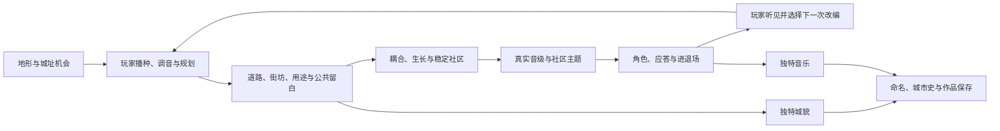

# 玩法改进评审：涌现与五个方向

2026-10-09。依据用户提供的五方向提案，以及“涌现很重要，应给玩家足够空间和大量组合”的补充进行整体评审。目标是让城市更好看、好玩、好听，并保持玩家对作品的掌握。

本文件是设计分析与试验输入。用户补充的涌现目标有效；本文提出的具体替代方案尚未成为新执行规则。现行实现仍取九份 spec，进度取 [PROJECT](../../../PROJECT.md)。

## 1. 总判断

**五个方向抓住了局间变化、配器成长和作品记忆，但完整移植会把本项目推向抽牌、叠加成、做任务驱动的城市肉鸽。当前最值得补强的是既有城市与音乐规则之间的组合关系。**

涌现与牌组并不矛盾，限制也不天然破坏涌现。决定价值的是：玩家是否能理解局部规则，用它们组成多种成立的关系，并得到没有逐个写好的城貌与音乐。卡牌数量、随机种类、地图数量都不能单独回答这个问题。

| 方向 | 本轮判断 | 吸收的内容 | 落地次序 |
|---|---|---|---|
| 城市 Profile | **合并改写** | 在已有 CityProfile 上形成不同空间机会；音乐性格由玩家建设发展出来 | 核心循环成立后，小规模验证两种城址条件 |
| 编曲牌组 | **不采用当前完整抽牌方案；吸收可组合的编曲技法** | 用已有章首选择承载改变关系的选项，城市仍是组织这些选项的载体 | 先证明配器与布局组合，再补 U09 |
| 三层元进程 | **延续既有方向，修正平衡论证** | 解锁表达材料、作品记录与起始条件选择 | 基础表达从首局可用；解锁后置 |
| 共鸣群岛 | **保留作品记忆价值，后移战役地图** | 保存、继续、作品画廊；主题确有作者感后再试跨城引用 | 保存优先；画廊其次；主题引用和地图更后 |
| 共鸣挑战 | **改为自选创作题，后置** | 给需要目标的玩家一个新角度，不占领普通建造体验 | 核心自由创作成立后再做独立题目 |

**当前优先级：局部选择的可听因果 → 规则组合 → 作品保存与继续 → 局间变化 → 解锁与挑战。** 能保存自己的城应尽早完成；复杂的跨局地图不替代保存。

## 2. 给涌现什么空间

### 2.1 五种空间

| 空间 | 玩家实际需要什么 | 要避免什么 |
|---|---|---|
| 地理空间 | 同一城址有不同可成立的布局、公共留地与连接方式，城能继续发展 | 每种 Profile 只留一条高收益路线；成形后无处修改 |
| 表达空间 | 音级、音域、用途、布局、主题、留白能独立选择并发生关系 | 把低音绑定一种用途，把主题限定为环形专属，把静默解释成少拿奖励 |
| 组合空间 | 一项材料能用于几种场景，局部规则能接到不同社区与时代 | 每张牌只服务指定套装；混合路线总是劣于纯路线 |
| 时间与注意力 | 能听完变化、比较未来、看城市生长，再作决定 | 每16秒同时处理抽牌、弃牌、任务进度、城市介入 |
| 修订空间 | 能试听、局部改编、保存版本；明确代价后仍能改变方向 | 一次实验永久抹掉主题或堵死生长；所有改变都要重开 |

这些空间不能用“地图更大、卡更多”代替。400–600栋需要规划工具和编曲组织；20–30栋则已经足够暴露选择是否单一、反馈是否清楚、组合是否成立。

### 2.2 本项目该追求的涌现

下面是需要成立的因果链，不是本轮声称已经实现的效果：

关键是城市变化与音乐变化出自同一组选择。例如：

- **河岸连接**：两岸各自有主题；桥改变真实连接与规则耦合，编曲再依实际关系组织呼应。玩家可以维持分离、建立连接，或把一岸经营成低音支撑。无桥跨河对唱与桥后首片应答目前是两个口径，不能提前合称一个已完成系统。
- **密度与留白**：集中商业使脉动更密；邻近公共空间降低局部主题密度。玩家用空间安排出“热闹的一段与安静的一段”，不必领取“织机＋公园”套装才成立。
- **历史与新声**：保留旧社区的主题和声音，再让新社区承担另一个角色。旧与新能组成新关系，时代更替便具有创作意义。

这三种关系共享现有的地块、社区、音级、事件与角色模型。先让其中一条可玩，再接第二条形成组合，比同时增加五套外层系统更接近当前目标。

### 2.3 约束放在哪一层

好听需要调内材料、共同时间网格、清楚音域和有限前景声部；好看需要自然几何、沿街关系、公共空间、统一光影和分尺度细节。这些约束能帮助大量组合保持品质。

**约束应限制合法材料与输出密度，把布局、分工、进退场和表达意图留给玩家。** 70个实际渲染声部的预算不等于只允许少数城市方案；限制同时演奏的数量，可以靠轮换与代表声部容纳更多社区。是否能让每个社区被认出，仍须听测。

“环形合唱城”“深流”“织机”等命名形态应给发现带来喜悦，同时保留无名字、混合和未成形城市的表达价值。精确识别条件本身并非错误；当它成为唯一获得主题或跨越的入口时，才会把创作变成照图填空。现行普通社区主题与三路径跨越正是应保留的出口。

## 3. 现有设计已经有哪些材料

| 已有材料 | 本轮含义 | 依据 |
|---|---|---|
| 深流低音、织机节奏两条表达路线 | 不需要先加牌组才能有 Build；要让实际布局与音乐差异成立 | [核心循环 §4](../../../文档/11_核心循环.md) |
| 稳定规划社区、用途独立于音高、音乐簇与编曲角色 | 为独立选择和交叉组合提供地基 | [世界模型](../../../文档/10_世界模型.md)、[城市生成管线](../../../文档/19_城市生成管线.md) |
| 社区主题、候选表达、张力与留白 | 作者感应从普通建设出现，不能全放到奖励和特殊模板里 | [核心循环 §5、§8、§11](../../../文档/11_核心循环.md) |
| CityProfile、分区混合2–3类形态 | 方向一已有结构性设计，不能再建一套平行同名规则 | [丰富城市技术深化 §3.1](技术深化-丰富城市生成与公共交通_2026-10-09.md) |
| 章首七次选择、时间胶囊、未来碎片、熔炉 | 方向二已有可承载“风格即构筑”的入口，内容池与叠加还缺定义 | [运行规格 R6 §2.10](../../../文档/01_执行规格/spec.run.md)、[U09](../../../文档/待裁定与依赖.md) |
| City DNA、曼陀罗、来信、图鉴、三模式 | 方向三和四应接已有作品生命周期 | [运行规格 R2、R5、R8](../../../文档/01_执行规格/spec.run.md) |
| 地标保护作品、同类效果递减方向、基础诊断信息不锁于稀有奖励 | 已吸收的竞品教训仍有效，不能借“新系统”重新引入问题 | [城市规格 E6](../../../文档/01_执行规格/spec.city.md)、[待裁定与依赖](../../../文档/待裁定与依赖.md) |

已有设计不等于已经好玩。第63轮已接小城、社区合奏、公共空间和两层落定切片；完整主题、三尺度、候选表达、通用城址和作品保存仍有待实施或待定义内容。具体边界见 [当前状态](../../../PROJECT.md) 与 [依赖清单](../../../文档/待裁定与依赖.md)。

尤其不能把音乐性权重 M 当成“同音最优已经解决”：现行全同音 R 仍为100，M降低的是邻接活力收益。只增加一栋异音也不保证恢复。丰富表达要靠真正值得选择的关系与听感，不能只靠一个多样性惩罚项。

## 4. 方向一：城市 Profile

### 4.1 留下城址机会，改掉路线特权

现有 CityProfile 已覆盖地形、中心、路网、街坊、密度、用途、绿地、交通、建筑与历史倾向。应把它与音乐关系接通：**这块地给我哪些创作机会，而我决定利用哪些。**

“城市想成为什么”可用于诗意开场；作为机械规则不能压过玩家想建什么。庭院、港湾、坡地这些城市条件，可以在分区和街坊层混合。音乐路线则由局内行为形成，不在开局指定最终风格。CityProfile与音乐性格需要有关联，不必一一对应。

| 原例子 | 具体问题 | 改写方向 |
|---|---|---|
| 河谷回响：跨河+3V、湖延迟更明显 | +1V首先改变成长收益；“更明显”没给出可执行音效与代价 | 两岸有不同可经营空间与呼应机会；延迟沿真实水面规则，听感由主题和组织产生 |
| 梯田赋格：生长与赋格更快 | 跳过塑造过程，强化指定答案；垂直音域与几何容量还要同时核对 | 提供分层台地和不同临街容量，玩家决定层间音域、顺序与联系 |
| 深流之城：低音天然锁定、竞争权重×2 | 降低角色竞争与空间安排的意义，提前奖励纯低音路线 | 低地有连续展开机会，上坡有较疏地块；玩家可做低音支撑，也可反向安排 |
| 织机之心：节奏槽2→3、减轻ducking | 占用工业时代已有新能力；增加并发密度且减轻自身代价 | 提供紧凑商业街与缓冲庭院，靠节奏安排、社区交接和留白发展律动 |
| 镜面群岛：独奏+5dB、距离10 | 响度直接偏置盲听；建筑对唱与社区应答本来就是不同距离口径 | 岛陆碎片形成独唱与应答机会；先统一对应的距离语义，不用更响证明更独特 |
| 古钟之城：地标连续2→1、隐世概率翻倍 | 撤掉稳定确认条件；首批六地标阶段没有隐世槽 | 从公共用地、空间历史与真实觉醒关系体现倾向，保留稳定条件 |

数值调节可以用于平衡；它必须服务于有代价、有替代解的选择。不能只用收益倍率或响度证明新的城市性格成立。

### 4.2 从两个条件开始，保留反向玩法

首个试验只用同一河谷中的两个结构条件：一类两岸空间较均衡，另一类一岸紧凑、一岸疏朗。两者都让低音、节奏、主题与留白有合法落点。每种条件至少能形成两种有吸引力的安排，混合安排也不因没有套装奖励而失去价值。

这两个条件是试验输入，不是新 Profile 目录。地形与初始结构沿 terrain 来源；音源与调式沿 mode；祝福沿 boons。现有 DNA 还有 charter_id，新 Profile 要先明确与宪章的关系，再记录生成版本、解析参数与选择来源；只保存一个新ID不足以保证长期重放。

**同一地形的两种 Profile 盲听不同，尚不能证明玩家有了更多空间。** 还要看同一 Profile 中两种玩家选择是否可辨、是否都成立，以及玩家能否改变开局倾向。

## 5. 方向二：编曲牌组

### 5.1 牌组有组合价值，但当前移植代价过大

卡牌可提供清楚的规则文字、有限材料和组合发现。这是有效设计手段。问题在于“选择音色”和“牌组构筑”只共享选择材料这一步；完整牌组还引入抽取分布、手牌、弃牌、循环、升级和机会成本。移植它等于重新分配玩家的注意力与控制权。

当前交响曲七章、每章12乐句，即84个活动乐句。每句抽一张会产生84次发牌；手牌上限5又要求持续使用或弃牌。相比现有七次章首选择，这是明显不同的决策节奏。它还带来四个整局变化：

1. **基础表达依赖抽取。** 想试低音、想建桥时要等牌，会削弱理解规则后主动试验的空间。基础建设与编曲工具不能由手气决定是否可用。
2. **另开操作额度。** “不占介入槽”改变建设、调音与地形行为的吞吐量，必须重算时代窗口、WorldDelta事务、破坏上限和成长节奏；每章用牌上限不能自动解决这些冲突。
3. **奖励绕过城市关系。** “低音槽+1”“节奏槽扩展”直接发编曲容量，降低通过布局、社区与角色竞争组织乐队的价值。
4. **稀有度与升级叠加。** 新牌若同时提供角色容量、活力与代价减免，就会形成收益滚雪球；U09现有封顶、寿命、互斥问题仍没有消失。

完整牌组能成为另一种产品方向，但要证明它带来的主动组合乐趣足以补偿这些变化。只检查“没有自由输入音符”不足以完成判断；反支柱也不是不可修改的教条，最终取舍仍取用户目标和实际体验。

### 5.2 吸收技法，让关系成为构筑

沿已有章首选择，先做少量可试听、可组合的编曲选项。它们应改变已有声音材料之间的关系，并说明占用哪个角色、替换什么、适用什么城市条件。例如，试验“现有社区主题由另一社区换音域接唱”时，来源必须是玩家真实主题，接唱须占现有角色与排程，不能额外叠一条无限前景轨。

重点是一个选项能用于河岸、山坡、旧城区等几种布局；两个选项组合后有新的安排，而不是分别把两个系数加大。具体选项内容、持续时间与叠加规则仍应回到U09定义，不能用“编曲牌”三个字把这些依赖跳过去。

卡面可以是短暂的表达方式，不必发展成常驻手牌栏。先不加每句抽牌、强制弃牌、牌升级和额外免费动作。材料选择发生在少数明确节点，材料如何组织则留在城市里。

## 6. 方向三：局内成长与局外元进程

三层分类能改善说明，但音源、形态、地形、图鉴、来信与城市史本来就在现有设计中。应整理它们的用途，不再叠一套“新元进程”。

**“只改变起始条件，所以不影响数值平衡”不成立。** 同样数量的起始材料，更早获得低音、保证拿到关键技法、选定适配地形，都改变机会成本、组合稳定性和达成目标的时间。它们可以是合理选择，但要当作起始条件平衡处理。

首局就应提供低音、节奏、普通主题、留白和基本修订能力。后续解锁新的表达材料与城址体验，不把核心组合推迟到“再赢三局”。扩大选项池还会稀释抽取概率；基础表达候选要继续可达，不能越解锁越难获得。

长期动力应同时包括掌握规则、发现关系、经营作品与收集材料。玩家发现“我能把上次那段旧主题发展成另一座城”，比单独看到解锁倒计时更贴近本项目。失败作品和自由共鸣作品也有创作价值，记录与基础发现不只奖励获胜。

每日城址与跨玩家比较需要明确内容池/版本/起始条件；拥有更多历史作品或解锁材料，不能无声地改掉同一个种子的比较前提。

## 7. 方向四：跨局世界地图与社区记忆

**这部分最值得留下的是作品延续感。** 本游戏让城市自动生长，玩家投入的是布局取舍和听觉选择。能认出自己以前的一段主题，能回到那座城继续改编，与“再来一局”的关系比纯数值奖励更直接。

先完成三件已有目标：保存并恢复一座城；把成品切到聆听；从作品画廊打开旧城。曼陀罗可作为索引，但不能代替真实城貌与声音。主题引用要等完整社区主题可重放、玩家能认出自己的片段之后再试。

引用时保存来源城市/社区、原始有序音序和排程、历史音色与生成版本。新城需要移调、映射音阶或替换音色时，保留原作品，试听改编结果并记录变换。进入当前编曲角色和声部预算；引用不赠送额外槽位、免费建筑或无限被动收益。既有建筑生成不能被“起始牌”越过合法地块流程。

5–8城址的群岛图可以成为后期作品浏览方式。当前没有证据支持必须加入邻接解锁、强制路线或世界重置；这些规则会让作品保存承担战役进度职责，也会限制想继续经营一座大城的玩家。先让地图帮助看见和打开作品，再判断是否需要战役。

引用历史动机还会改变复现前提：同一新城种子配不同旧作品就不是同一局。把引用作为显式开局选择进入DNA；标准每日条件独立于个人作品历史。单纯记录第二局“含有第一局主题”只证明数据传递，真人是否认得、是否愿意改编才证明记忆价值。

## 8. 方向五：共鸣挑战

挑战能引导玩家尝试陌生关系，也能把他们导向标准答案。对涌现而言，合适的创作题可以暂时收紧一项条件，让剩余组合更值得探索；强制同时收紧音阶、地形和城型则会压缩空间。

原方案应逐项分开处理：

| 原挑战 | 判断 |
|---|---|
| 全局五声，时代Ⅱ暂不可用F/B | 是实际能力限制，即使没有失败处罚。只能作为玩家主动选择的专项题，不改变普通时代“只增加、不没收”的承诺 |
| 不可挖湖、河道不可改 | 可以形成城址条件或专项规则；不能一面宣传丰富地形动词，一面每局随机拿走基础试验工具 |
| 第3章前形成环形合唱城 | 更接近指定模板与限时作业；普通玩法不靠它定义成功 |
| 古典社区保留到终章 | 与作者感契合，但要先确保历史街区工具可达、保留粒度与声音意义成立 |
| 曼陀罗留白≥35% | 现行留白已分尺度，导出图的空白又是另一种测量。比例不等于好构图，不能用它给作品审美打分 |

后期先做**自选的一项创作题**，例如“尝试让两片社区相互回答”，允许多种形态和音域安排。开局说明规则，途中需要时可查看，完成后保存一段能看到、听到关系的作品片段。奖励用记录或展示，不把关键编曲能力与数值收益锁在题目里。

普通交响曲让章节和城市机会提供节奏；自由共鸣保留玩家自定目标；聆听模式不抽牌、不派任务、不催促。挑战不按城市增长自动越生越多，忽略它也不出现一串长期欠账。这延续了现有反任务膨胀的取舍。

## 9. 五方向如何收成一套游戏

**城址提供不同材料与空间；玩家用共同规则组合城市；少数章首选项扩展关系；作品保存发现与历史；解锁和自选题提供再次探索的理由。** 每层只有一个明确职责。

| 模式 | 城址与局内表达 | 局间内容 | 挑战与节奏 |
|---|---|---|---|
| 交响曲 | 共同规则、七章、少数阶段性选择 | 保存、聆听、继续或新城 | 自选题；不加每句手牌管理 |
| 自由共鸣 | 长期生长、局部改编、混合时代 | 保存版本与作品画廊 | 玩家自定目标；章制额度的现有缺口仍需闭合 |
| 聆听 | 演奏已有作品 | 从画廊打开作品 | 无新奖励压力，不推进建设任务 |

Profile、起始材料、挑战若同时偏向低音，再配永久保留的主题收益，会形成三层同向加码，混合路线失去竞争力。它们不能分别审查后全部叠上。反过来，把地形、配器、形态、记忆拆成互不相干的五个菜单，也不会产生涌现。

### 好看、好玩、好听各要得到什么

- **好看**：组合沿岸线、路网、街坊和公共空间长出有层次的轮廓；全城与社区有各自的留白；沿现有自然几何、统一光影和色板建立一致性。装饰可以单独有美术价值，不必把每一棵树都变成规则增益。
- **好玩**：玩家能预判局部结果，在几种都值得选择的安排间作取舍；局势有发展，旧选择可继续被利用和修改。新鲜感来自发现关系，而不是读更多选项说明。
- **好听**：主题可辨，低音有支撑，节奏有推进，社区会让位与呼应；新增城体丰富织体与空间，不靠更响、更密、更长的奖励音。复杂组合经过角色与输出约束组织后仍听得清。

## 10. 下一步：只验证一个有组合深度的切片

先用当前20–30栋制作范围完成一处关键选择的因果，再用同一城址从同一快照走三种安排：偏低音、偏节奏、两者与留白的混合。基础工具相同，保留相同初始材料和比较时段。目标不是三套固定配方，而是检查混合有没有表达价值、玩家能否用自己的布局形成结果。

第一轮只问四件事：

1. 玩家能否在画面和声音中指出自己的一次选择造成了什么？
2. 同一城址的不同安排是否可辨，并且各有吸引力？
3. 后来一项选择能否利用之前的关系形成新结果，而不是仅多一层声音？
4. 玩家是否主动想再改一处、保存作品，或换一种组合？

复用现有 HUMAN-EXPRESSION、AUTHOR、DIFF、CANDIDATE、NOTASK 的意图，在一次短试玩中登记对应观察，不另造庞大测试矩阵。现有正式门槛不因这份试验解释被改写，短观察也不标整项通过。

30秒盲听只验证可辨性。要控制比较时段与监听响度，避免+5dB或刚好轮到不同社区造成虚假的策略差异；监听副本的响度匹配不改游戏固定公共增益。若结论专门涉及四乐句轮换，30秒不足以覆盖64秒周期，再延长该项记录即可。

只有真实改动音频时，才针对新增排程检查声部预算、真峰值和供音；改布局时检查合法落点、身份稳定与真实连接。当前文档评审不重跑历史游戏合约，也不把旧技术PASS当成这三条表达路线已好玩。

这个切片成立后再试第二种城址条件；保存紧接已有作品模型完成；章首技法随U09补齐；元进程、主题跨城和自选挑战逐层加入。**扩大组合关系先于扩大目录。**

## 11. 竞品核查与吸收边界

本轮按EXA优先、Tavily补充检索。EXA后续达到免费额度，转用Tavily，未使用Brave。网页事实与本项目设计判断分别列出；宣传描述不等于本项目的好玩证据。

| 一手或官方来源 | 能确认什么 | 本项目吸收什么、不能据此推出什么 |
|---|---|---|
| [Combolands开发者商店页](https://store.steampowered.com/app/4075620/Combolands/) | 7公会选2、21组合；建筑协同与连锁是核心，明确追求数值增长爽感 | 学习材料之间的协同。21种组合只是组合计数，不证明21种同等有趣玩法；不能照搬为六个城市增益包 |
| [Drop Duchy开发者日志](https://sleepymillstudio.substack.com/p/resources-farming-and-dropping-the) | 农场把相邻平原变为田地，田地与磨坊/瞭望塔等效果相接；资源和卡牌成长相连 | 关键是前一条规则产物能成为后一条规则输入。把音色写成卡面，尚未得到这种关系 |
| [Against the Storm官方Wiki：升级](https://wiki.hoodedhorse.com/Against_the_Storm/Upgrades) | 升级包含永久生产、移动等数值加成，也解锁选项 | 本项目可保留选项解锁约束；不能称原作已经验证“完全没有数值成长”的长期动力，也不能据此承诺150–200小时内容 |
| [Against the Storm官方Wiki：世界地图](https://wiki.hoodedhorse.com/Against_the_Storm/World_Map) | 地图承担出发选址、可达范围与周期进程，周期有结束与重新出发 | 世界地图有战役职责；不能把这套职责默认塞进强调保留大城与作品的游戏 |
| [Dorfromantik开发者商店页](https://store.steampowered.com/app/1455840/Dorfromantik/)与[官方presskit](https://www.toukana.com/dorfromantik/presskit) | 程序化板块、空间组合、任务补充板块；另有创意与自定义模式 | 学习简单输入产生丰富构图及模式分工。“反应式Rimworld叙事者”未在所读官方说明中得到支持，不据此设计新叙事AI |
| [Memoriapolis开发者商店页](https://store.steampowered.com/app/2228280/MEMORIAPOLIS/) | 多时代、六类文化、选择影响成长与城市收藏 | 学习城市历史与组织差异；更多时代、奇观本身不证明组合深度或后期耐玩 |
| [Generation Exile开发者商店页](https://store.steampowered.com/app/2963240/Generation_Exile/) | 开局程序化角色，其技能、能力与性格影响叙事和策略 | 学习变化的材料确实进入规则与叙事；不必复制角色管理和生产链 |
| [Townscaper发行商官方页](https://rawfury.com/games/townscaper) | 基础工具从开始可用，算法依据构型生成房屋、拱、楼梯、桥和庭院 | 这是当前已有美术参考中最接近“少规则、多结果”的例子；其玩具定位不证明本项目无需持续决策 |

Town of Tinysville、HexLands、Islanders: New Shores、Super Fantasy Kingdom与Toxic Frontier在原提案中提供题材或机制参照。本文没有核查它们的全部现版本，不把相关宣传句或模式数量当作设计证据；本轮取舍也不依赖这些数量。

## 12. 阅读、备份与验证记录

通读范围截至本轮阅读清单：`文档`中53份Markdown，以及1份SVG、1张PNG和2份导入元数据；排除目录名含“存档”或“废弃”的目录。阅读期间现行入口与部分规格有同步整理，已补读新增入口、依赖和一致性审查，以及发生变化的规则。历史执行记录仅用于理解实际实现与教训。

Git评审前快照：`codex/backup-before-emergence-review-20261009`，快照提交 `8882c58542035fa36b37e941018f264f163d983e`。完整bundle已verify；进入时差异、未跟踪文件及阅读范围哈希在`.git/任务备份/玩法与涌现评审_2026-10-09/`。本轮重要文件未删除。

本轮产出为本评审、PROJECT中的用户涌现目标及[文档核对记录](../../../验证记录/文档/2026-10-09_玩法与涌现评审.json)。验证限定于阅读范围、文档引用和本轮差异；没有新玩法实现、真人体验或声音品质通过结论。
