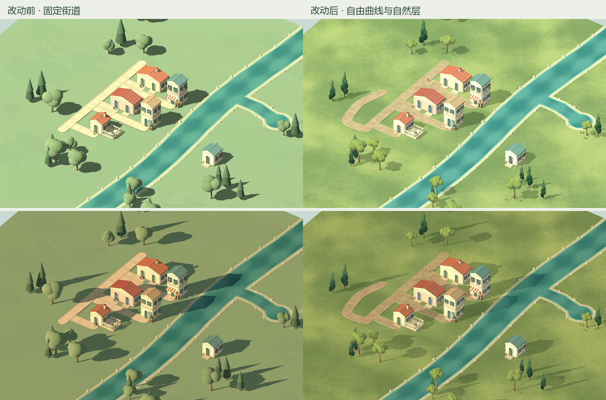

# Tiny Glade 方向 · 自然与道路

2026-10-14，Godot 4.7.2 / Compatibility / RTX 5070 Ti Laptop / 1440×900。美术以本地 Tiny Glade 参考库为基础，道路以自由画、顺滑衔接为目标，另有两点直拉。

参考已读 `reconstruction_resources.md` 与 `reconstruction_grass2.md`：确定性实例、冠层/草高低色阶、遮挡移除、顶端风权重、共享exemplar与空间裁剪。Curve 逐段投影/弧长语义用于路径组织。这里的树/草/几何/材质为原创Godot实现，没有复制原版素材或声称复现完整Grass2 GPU渲染器。

左侧是改动前固定街道，右侧增加同种子自然层及一条自由曲路，两个场景的建设量不同；不是逐像素同几何A/B。基础6房与水渠/塘一致。后图有居民正常活动，前图仅截图时暂停居民。

| 交付 | 实窗 |
|---|---|
| 全景 | [白昼](after/city_day.png) |
| 街坊 | [白昼](after/street_day.png)、[夕光](after/street_evening.png) |
| 墙面编辑尺度 | [近景](after/house_day.png) |
| 改动前 | [全景](before/city_day.png)、[街坊](before/street_day.png)、[近景](before/house_day.png) |
| 500株密度夹具 | [全景](stress/city_day.png) |

## 改动

原创橄榄/柏/灌木各3个共享变体，分枝与不规则叶团合并网格，基准单株1156/1020/640三角；高低顶点色、包裹叶光、GPU连续风。林缘按8米块生成草花石，最多3批MultiMesh，局部mask复用生产可见性规则，无逐帧CPU扫描。地面低频色阶、草顶亮根暗、房基接触层和环境填充改善接地。

工具3自由曲线/两点直拉。笔画去重复/共线、3.5cm去抖、受限共享Hermite切线和20cm弧长采样；首末点保留，预览/提交相同。连续圆端轮廓、相交路缘退让，稳定ID决定裁面归属，路口不叠面；水桥细分网格并统一中心线高度。撤销恢复原路，相关旧路接头一起更新。

## 验证

`tests/test_city_creation_stroke.gd` PASS：首末点、平直简化、插入共线点等价、曲线切线、圆角、闭合/回折、直拉。

`tests/test_city_creation_nature_render.gd` PASS：2304局部mask点与完整真值一致，远水编辑保留7个草块；路口只有1层材质面；桥内180顶点同高度且法线向上。细分后出现极小退化三角，已剔除并复验。

完整viewport输入 `test_city_creation_play.gd` PASS：原房屋/露台/路桥/植被/水岸/生活，新增直拉中间绕行轨迹→仅两端直线、撤销；revision22，采购9、小聚7。原状态、水域和跨水生活合约PASS。

有声自然街坊300帧约180 FPS，delta p95 5.56 ms，462绘制调用、252600三角；一次自由曲路更新2路（新路+接头）、1植被块、3草块，总18.018 ms。见 [街坊性能](after/performance.json)。

500株合成密度夹具+5374草花石、24块，约180 FPS，delta p95 5.56 ms，989绘制调用、1262668三角。初次174.740 ms（草116.973 ms）；单块5.292 ms（草1.167 ms），其他草块保持。早期完整草query约480ms，局部mask降低成本；仍需分帧/分块初始化。见 [压力原件](stress/performance.json)。夹具只测本机密度渲染成本，不证明大城/低配性能或合法画笔容量。

复跑：`Godot --path . --script res://tools/check_creation_art.gd` 输出三尺度/昼夕图与有声性能；加 `-- --art-stress` 为500株。头less运行相应测试。夹具初始化前禁用个人存档读取/保存。

## 未完成

自然岸石仍规律、建筑体块和接缝需打磨；完整距离LOD、软阴影滤波、大城分块尚未交付。自由道路仍避墙/要求完整跨岸，没有自动开建筑门洞；极复杂自交/环回的路缘和桥网需要后续实窗验证。形状校验、居民路网、网格生成仍随长笔画段数增长。

Git基线 `backup/pre-art-grove-20261014`；修改前文档与renderer/UI保留 `备份/美术林缘前_20261014/`，先前水岸提交 `83d5cf0` 可完整回退。
