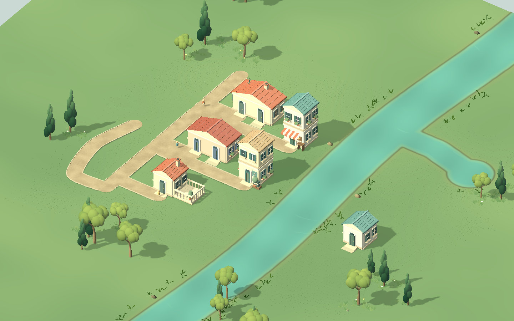
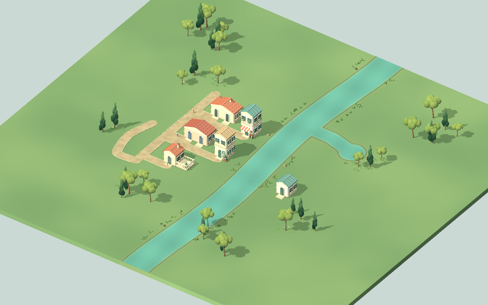
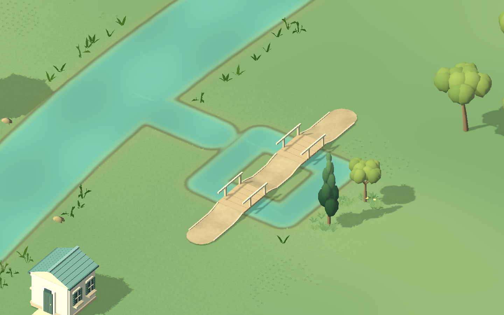
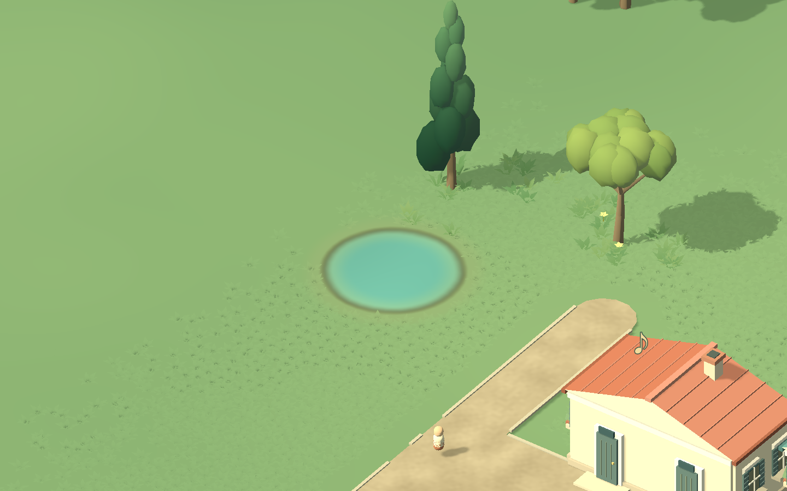
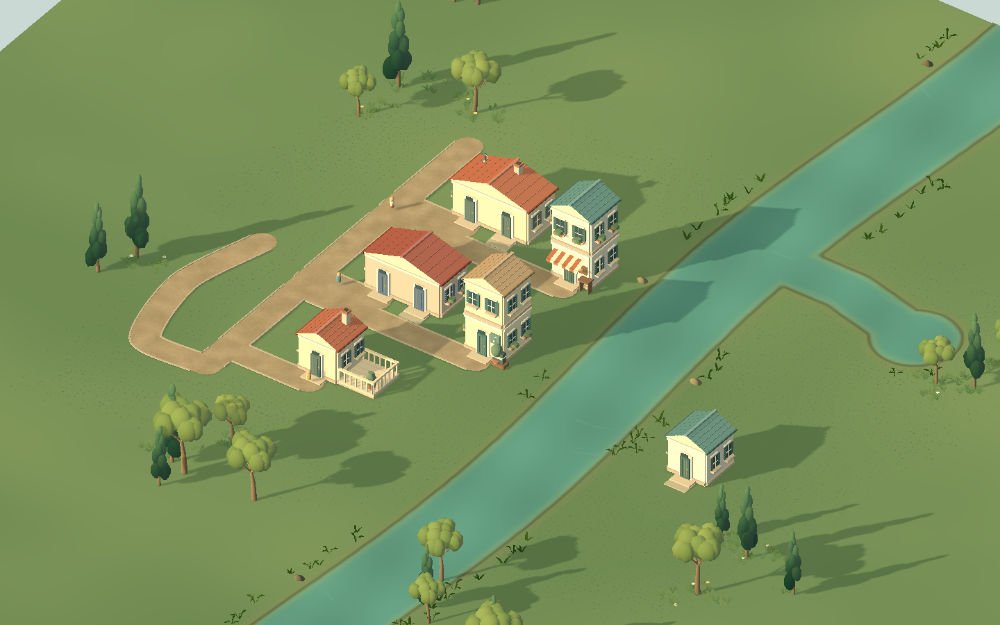

# 自然水岸、共享岸距与连通水面缓存 · 2026-10-14

移除原整齐的圆柱边石和叠放深/浅水平面。完整水域只保留一层真实并集表面，深浅、湿土、草底由共享岸距融合；水色保持低频纹理和稀疏亮纹，风/水使用TIME，不依赖音频。原创低草、缩短加宽的芦苇与扁圆岸石按低频簇分布，留出空岸，背景延续到编辑矩形之外。

借鉴 [Tiny Glade水域遮罩/距离场研究](../../参考资料/Tiny-Glade逆向成品-v2/reports/shaders.md) 与 [Grass2研究](../../参考资料/Tiny-Glade逆向成品-v2/reports/reconstruction_grass2.md) 的系统拆分；几何、代码、风与材质由本作制作，不读取参考游戏媒体。这不是其完整渲染算法还原。

## 正确性与缓存

60×56米场域使用256² RF岸距纹理（262144字节），像素中心取精确State水距并截断±1.6米；4米桶减少胶囊查询。只在水编辑重算改变笔画影响范围，删除/撤销同样更新，远处RF字节保留，ImageTexture身份不变。GPU每次仍上传这张小纹理，CPU只重算局部；建设、桥、居民和植被合法性仍使用解析真值，不读视觉插值。

水面按保守包围盒连通组件缓存；可能相交的轮廓放在同组做精确并集/带孔三角化，不相连池塘保留原网格。岸草/芦苇/石按8米块MultiMesh缓存，种子与参数先生成再避让，撤销恢复同一变换。岸石12点椭圆检查房基、门、路、水及跨块依赖；GPU缩放只改变细节，名字/上层/植树/街坊等不改变岸距和岸边布局。

| 验证范围 | 结果 |
|---|---|
| RF场密集真值 | 458752个中心精确匹配；加入/合并/变宽/移位/删除/撤销/存载/退化胶囊PASS |
| 双线性非中心采样 | 16384点最大误差0.046460米；理论上界0.160925米，只用于颜色 |
| 场缓存 | 无变化零重算/上传；变化保持纹理ID及远处字节，初始化37.215ms，单塘约1.222ms |
| 岸边布局 | 基础62实例/10块，30芦苇/4石/28编辑域外；初建16.812ms；合水隐藏3处旧内岸，路/桥移除2处，6无关块保留，撤销变换/缩放节点保持PASS |
| 实际生产水面 | 合流/闭环处恰一层，小岛不填；RF纹理由地面/草底共同使用，4背景岸块保留PASS |
| 实际独立新增池塘 | 既有水面组件全部保留，撤销恢复全RF字节，754局部像素重算、480像素改变PASS |
| 原自然/路口/桥与完整输入 | 6144完整草候选、15无关草块、180桥顶点及viewport/生活回归PASS |

## 有声性能

Godot4.7.2 / Compatibility / RTX5070Ti Laptop / 1440×900。音乐准备完成、居民/面包师活动后记录300帧，约180FPS、delta p95 5.56ms。

- 4笔水域含小岛/交接：水几何6.433ms、岸距5.527ms、10岸块12.739ms，总43.768ms，未重建无关房路。
- 在上述场景新增独立池塘：水几何0.358ms、岸距0.999ms、4岸块5.470ms，总15.465ms。此前同夹具重建全部水几何12.051ms、总26.567ms；本轮组件缓存保留既有网格。
- 原6房/7路/2水的三尺度河湾另作同镜头图；数据见 `after/performance.json`。四笔水域数据见 `water/performance.json`。

数字仅覆盖本机小河湾，不证明大城/低配；多笔集中修改43.8ms仍超过单帧预算，连接到既有河流/闭环时仍需重建整个相连组件。初始化RF约37ms，岸边约17ms；后期需要更细的几何分块或分帧建立。

## 对照与近景

此前整齐色带/岸石：


现在的水土草过渡：











近景为平面水岸原型，没有真实挖低地面、坡地基础、倒影或水文。本轮减少规则边框和水层叠面，建立共享过渡与局部缓存；草叶、岸坡、水色、地形起伏与最终Tiny Glade观感继续制作，技术PASS不作为美术签核。

```powershell
& 'D:\GODOT\Godot_v4.7.2-stable_win64_console.exe' --path . --headless --script tests/test_city_creation_water_field.gd --quit-after 1800
& 'D:\GODOT\Godot_v4.7.2-stable_win64_console.exe' --path . --headless --script tests/test_city_creation_shore.gd --quit-after 1800
& 'D:\GODOT\Godot_v4.7.2-stable_win64_console.exe' --path . --script tools/check_water_performance.gd --quit-after 1800 -- --natural-shore
& 'D:\GODOT\Godot_v4.7.2-stable_win64_console.exe' --path . --script tools/check_creation_art.gd --quit-after 1800 -- --natural-shore
```

原始日志：`field_contract.log`、`shore_contract.log`、`nature_contract.log`、`play_regression.log`、`art_runtime.log`、`water_runtime.log`。夹具初始化前关闭个人持久化。基线 `backup/pre-natural-shore-20261014`；旧水层/着色/边石移入 `废弃/自然水岸_2026-10-14/`。
