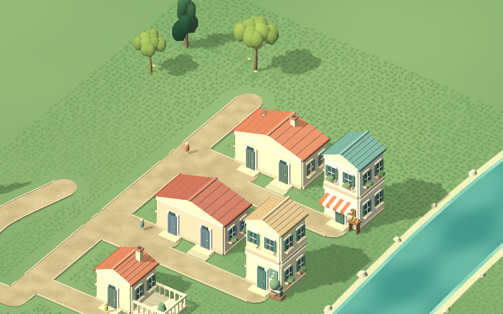
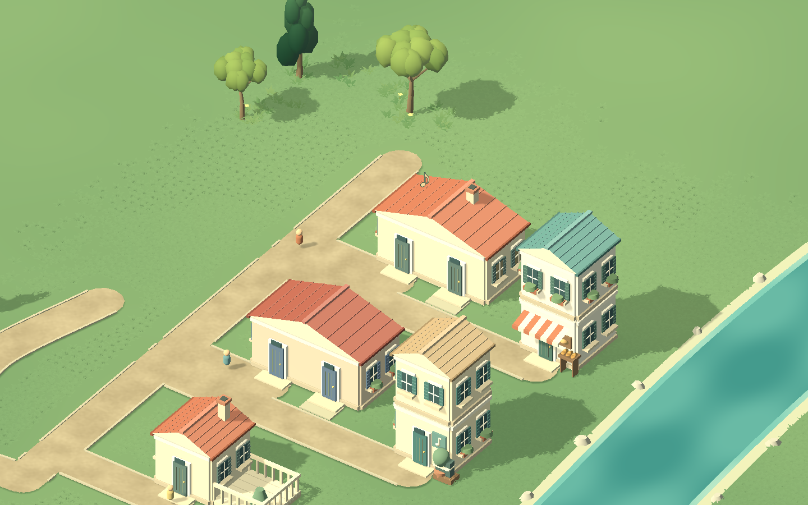
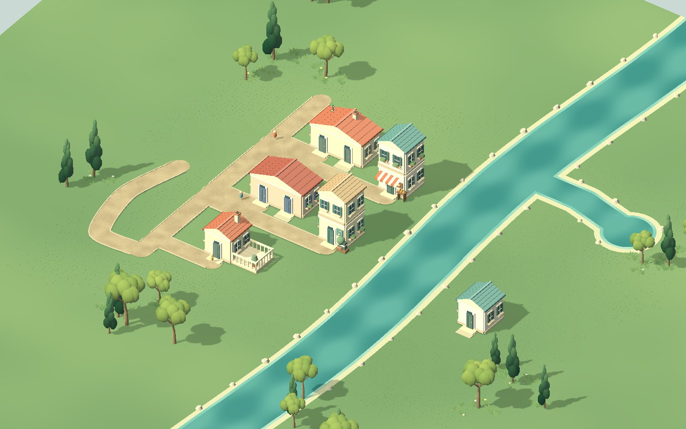
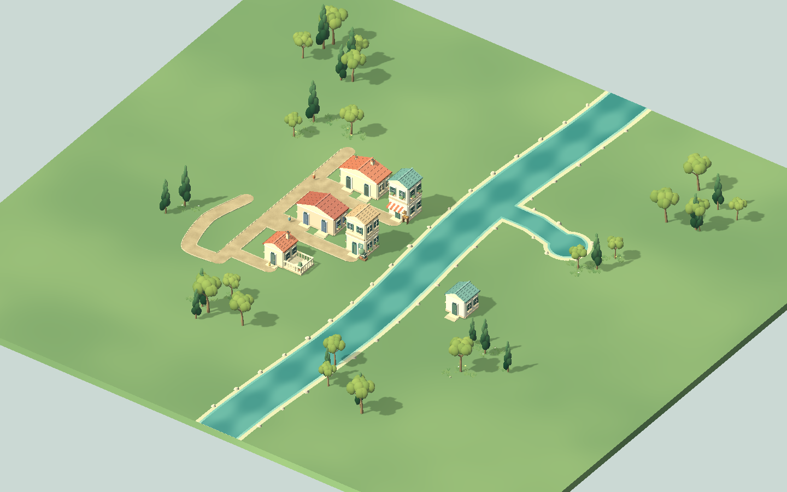
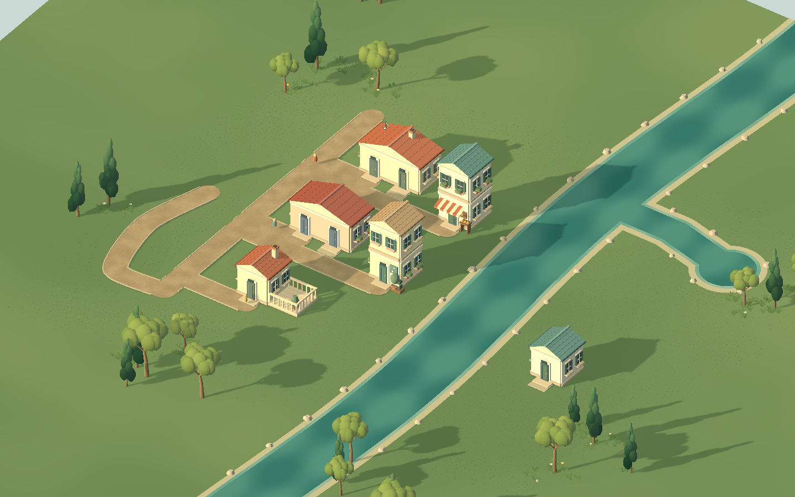

# 草地融合与局部编辑成本 · 2026-10-14

草底与地面共用世界坐标噪声、source_color 色阶和漫反射模型。近景显示低矮宽叶，正交镜头 zoom 12→32 连续收起细节；范围边缘按低频起伏和固定哈希稀疏过渡。林缘草花石仍独立保留。全部几何与着色器由本作生成，不读取参考游戏资产。

8米块内建立1米索引，预计算房基、真实外露门和路水胶囊；只有空间变化才重算草底。植树重用草底记录及原 MultiMesh 节点，缩放仅调共享材质，不重新采样、上传实例或重置居民。

## 结果

Godot 4.7.2 / Compatibility / RTX 5070 Ti Laptop / 1440×900。有声PCM准备完成后，居民继续活动，记录300帧。

| 验证范围 | 结果 |
|---|---|
| 密集/epsilon边界/外露门/相切块边界 | 98,940 个完整候选与生产植被规则一致 |
| 三条49点曲路的索引压力 | 单块961次查询1.262 ms，最大索引建立0.651 ms |
| 实际草层/路口/桥网格 | 6,144点一致；15无关块保留；180个水上桥顶点高度与朝向正确 |
| 相机缩放与单株编辑 | 已有草底GPU节点全部保留 |
| 6房/7路/2笔水域/24草块 | 7,791草底 + 304林缘实例；约180 FPS，delta p95 5.56 ms |
| 新增同一条自由曲路 | 6草块10.668 ms，总重建24.829 ms；此前草95.797 ms、总108.839 ms |
| 500混合小树/灌木替换压力 | 16,948草花石实例；24块重建66.362 ms，其中草29.398 ms；约180 FPS，delta p95 5.56 ms |
| 压力场景单块编辑 | 总2.318 ms，其中草0.596 ms；无关块实例保持 |

500株数据直接注入密度夹具，用于批量成本比较；24块替换已复用此前有效草底，不代表冷启动或合法笔刷布局。帧率受本机180帧上限影响，未测低配或大城。

旧草mask夹具缺少id/seed/source，生产校验会拒绝候选，双侧拒绝无法证明几何等价。本轮改成完整有效候选，并用独立密集/边界测试及真实场景重新验证。此前记录中的2304/6144点mask结论由本记录替代，路口、桥和缓存验证仍独立有效。

## 图像

此前均匀颗粒与笔直草界：



现在的近景融合：









## 复现命令

```powershell
& 'D:\GODOT\Godot_v4.7.2-stable_win64_console.exe' --path . --headless --script tests/test_city_creation_grass_mask.gd --quit-after 1800
& 'D:\GODOT\Godot_v4.7.2-stable_win64_console.exe' --path . --headless --script tests/test_city_creation_nature_render.gd --quit-after 1800
& 'D:\GODOT\Godot_v4.7.2-stable_win64_console.exe' --path . --script tools/check_creation_art.gd --quit-after 1800 -- --grass-blend
& 'D:\GODOT\Godot_v4.7.2-stable_win64_console.exe' --path . --script tools/check_creation_art.gd --quit-after 1800 -- --grass-blend --art-stress
```

全部PASS。原始输出：`mask_contract.log`、`nature_contract.log`、`runtime.log`、`stress_runtime.log`；数据：`after/performance.json`、`stress/performance.json`。夹具在初始化前关闭持久模式，不读取或写入个人作品。

曲路总提交仍超过一帧16.67 ms；全块替换仍有66 ms集中工作。世界是平面，坡地、岸边轮廓与最终Tiny Glade草地观感未完成。这里交付颜色、层次、边界和局部成本改善，不宣布美术目标完成。基线标签 `backup/pre-grass-blend-20261014`；旧整块遮罩和第一版字典索引移入 `废弃/草地融合_2026-10-14/`。
