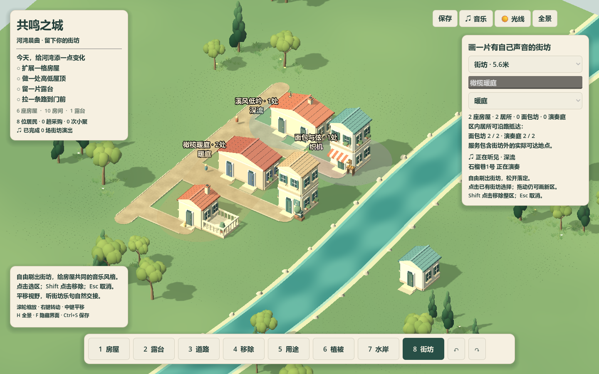

# 街坊划区、生活可达与三种晨曲 · 2026-10-14

工具8自由刷出连续街坊，单点为圆形，多点为圆头笔画；松开一笔落定，点击已有区选中、命名、改风格，Shift移除整区，Esc取消。后画区域拥有重叠位置；房屋以稳定origin派生归属，扩房不漂移，新房自然加入。空街坊保留意图，不自动长房，不自动改用途。

面板按真实房屋用途显示成员，区内居所只有沿实际路网抵达全城面包坊/演奏庭才计服务可达。没有桥的右岸居所仍为0/1；隔河音乐仍可参与，不把音乐连接与道路混为一项资格。

暖庭保留原木质主题，深流用低缓长呼吸，织机用稀疏和弦拨弦。共用24秒D大调五声音阶底座、3秒乐句。镜头焦点14米内真实房屋轮换，范围空时取最近真实房屋；焦点/风格变化下一乐句进入，所有播放器保留相位。选中房屋的实际可听轨道驱动亮窗/音符，界面说明正在发声的房屋。静音清提示、演出接管主旋律，活动/建设继续。

## 实际结果

Godot4.7.2 / Compatibility / RTX5070Ti Laptop / 1440×900。PCM准备完成、居民正常活动后测300帧：约180FPS，delta p95 **5.754ms**。三块区域添加与整合约 **2.682ms**，没有重建房屋/道路/草地，也没有更换居民节点。

| 验证 | 结果 |
|---|---|
| `test_city_creation_districts.gd` | 94 checks PASS：保存回读、旧档缺省、有效几何/名字、恶意字段原子拒绝、重叠归属、新房归属、撤销分叉ID、生活/行程保留 |
| `test_city_creation_district_input.gd` | 真实OpenGL viewport PASS：8/连续拖刷/点击选择/名字与风格/输入隔离/undo redo/Esc/Shift整区移除/区层显隐/区外服务与右岸无桥 |
| 原状态、水域合约 | PASS |
| 原完整输入/生活回归 | PASS：真实viewport编辑、居民9趟采购/7次小聚，见 `play_regression.log` |
| 新有声整合夹具 | PASS：实际听见h1深流→h2织机→h3暖庭；城改即时、声音等待边界；相位不重启；镜头焦点改变后h6发声；静音/公共演出退让；七轨同步差<0.06s |

音频固定 **7条**共享PCM、4个短编辑效果播放器；不随街坊/房屋数量增轨，PCM共7,408,800字节。含全部预设过渡尾音与4个编辑效果的绝对峰上界 **0.487<1**。单预设实际bank按生产目标增益导出的峰：暖庭0.0677、深流0.0695、织机0.0546；循环边界阶跃均0.000347。导出未经归一化，各24秒/22050Hz/16bit单声道；三份生产PCM不同。





试听：[暖庭](warm.wav)、[深流](deep.wav)、[织机](weave.wav)。数据与实窗日志：[report.json](report.json)、[runtime.log](runtime.log)。

```powershell
& 'D:\GODOT\Godot_v4.7.2-stable_win64_console.exe' --path . --headless --script tests/test_city_creation_districts.gd --quit-after 1800
& 'D:\GODOT\Godot_v4.7.2-stable_win64_console.exe' --path . --script tests/test_city_creation_district_input.gd --quit-after 1500
& 'D:\GODOT\Godot_v4.7.2-stable_win64_console.exe' --path . --script tools/check_creation_district_music.gd --quit-after 12000
& 'D:\GODOT\Godot_v4.7.2-stable_win64_console.exe' --path . --headless --script tests/test_city_creation_play.gd --quit-after 1800
```

所有viewport夹具初始化前关闭个人持久化。schema1向后兼容增加districts/next_district_id/high_watermark.district，缺省为空；坏档不覆盖当前城市。音乐设备相位不写入作品，恢复时保留街坊与预设后重新建立共同音乐时钟。

本轮提供音乐街坊与真实服务信息，没有实现住宅/商业/文化的模块生成倾向、生产供给/工作容量、独听/音乐连接、真正的3D空间音频或完整视野/远端应答调度。焦点圆与乐句锁定是当前来源选择，不能冒充完整视野可见性。三种音乐为原创程序小品，听感/乐趣仍需实际体验；性能只覆盖本机小河湾，不覆盖大城或低配。基线 `backup/pre-district-music-20261014`。
