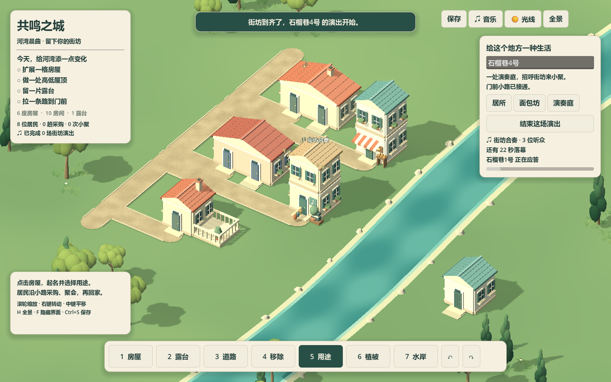
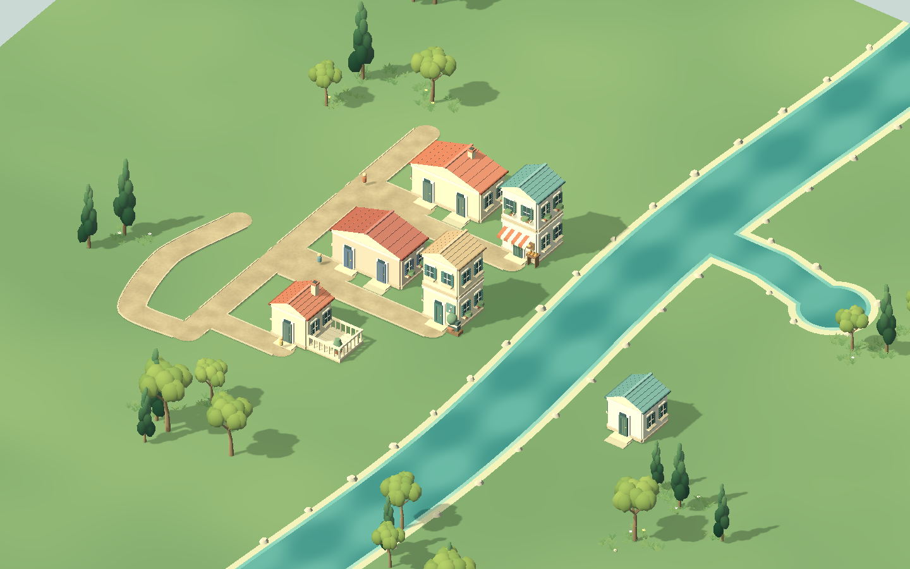

# 街坊演出、房屋应答与草地第二轮

默认新河湾选工具5→演奏庭→邀请街坊演出。居民沿真实小路赴约，到齐后24秒演出；演奏庭和参与房屋轮流主奏/应答，窗光与音符按实际播放来源出现，结束恢复日常。提前结束/断路/用途改变取消，不结算完成场数。

日常配乐也分配到实际房屋ID并轮换来源。听感优先于数量，全部通过5条共享PCM编排；没有逐栋新建音轨。当前仍为原创程序小品、单声道共享声部，区域风格/音乐连接/空间音频未实现。

## 试听

取自游戏实际PCM bank，不做响度归一化：

- [河湾日常 · 24秒](河湾日常_原创程序小品.wav)
- [街坊演出 · 24秒](街坊演出_原创程序小品.wav)

演出琴声主奏与木质应答每3秒交替；普通木/气声退让，结束约1秒淡回。静音立即归零并停止编辑音，所有播放器相位和居民生活继续。来源轮换复用稳定房屋身份，音乐切换不重启、城市不等拍。

## 验证

`test_city_creation_concert.gd` PASS：真实邀请、到齐后播放、24秒完成一次；日常步行/驻留、赴约中、演出中、完成后、断路暂停的真实保存回读；无关编辑保持、断路/用途/玩家取消不计数；坏位置/等待/嵌套日常/成员/时长原子拒绝；最近断开支路不屏蔽附近目标可达路段。

`test_city_creation_state.gd`、`test_city_creation_life.gd`、`test_city_creation_play.gd`、`test_city_creation_nature_render.gd` PASS。输入和空间规则保留。

`tools/check_public_concert.gd` 实窗按钮邀请3人、实际步行到齐，在真实音频时钟观察到来源 `h4/h1/h3/h5`；每个来源有应答截图。静音清可听标记、活动保持，结束场数1、普通小聚0。报告 [play_report](play_report.json)，画面 [邀请](invitation.png)、[演出](playing.png)、[落幕](finished.png)。1440×900 / Compatibility / RTX 5070 Ti Laptop；最新实窗采样Engine FPS为151，delta p95 5.56ms；前次相同夹具180FPS。重复PCM导出同时运行的一次p95曾16.287ms；最新采样仍存在其他Godot进程，不将本机结果当作低配或大城成绩。

`tools/export_creation_concert_audio.gd` PASS：五轨529200帧/22050Hz，共5292000 PCM字节；实际PCM峰值与接缝，淡入/退让/恢复、同步时钟、立即静音与静音继续、真实主奏/应答来源。演出最大规模混音峰0.096735，包含4编辑音的保守绝对峰界0.430890，小于1。原件 [audio_report](audio_report.json)。首版导出每个样本读取stream.data导致反复复制1MB，已改为每轨缓存一次；全部真实PCM检查及导出约2.5秒完成，后续实时时钟检查另计。退出先释放播放资源并等待一次音频缓冲后关闭，最新运行日志无ObjectDB泄漏警告。

## 草地变化与边界

已按用户反馈降低平地噪声对比，草刺变为低矮宽弯叶（18三角/簇，高0.12–0.25米），减根顶反差、增加密度并统一向上受光。当前仍是平面底色+共享草簇，连续丰润草毯/自然坡地/TinyGlade最终观感尚未达到。

三尺度/夕光见 [全景](grass/after/city_day.png)、[近景](grass/after/house_day.png)、[夕光](grass/after/street_evening.png)。旧证据保留在前轮Git及 `废弃/验证记录/2026-10-14_草地色阶调整前/`。新500株密度夹具+9157草花石/24块，有声约180FPS、p95 5.56ms；初次160.810ms（草123.734），单块2.688ms（草1.009），其他草块保持。见 [压力性能](grass/stress/performance.json)；当前证据不覆盖大城或低配。

## 持久化与复跑

schema1增加 `life_progress.concerts`、`journey_checkpoint`，旧字段缺省为空。居民保存home/当前位置/目的地/驻留剩余等待/stops/演出阶段与成员，load后按当前真实路网与用途重规划；非法语义不产生虚假完成。编辑撤销保持已发生生活；正常继续每15秒/手动/关闭捕获行程。音频设备相位未保存，载入演出恢复声部而非精确音频采样点。

`Godot --headless --path . --script res://tests/test_city_creation_concert.gd`；实窗用 `tools/check_public_concert.gd`，试听导出用 `tools/export_creation_concert_audio.gd`；草图用 `tools/check_creation_art.gd -- --concert-nature`，加 `--art-stress` 为500株。独立fixture不读/写个人作品；演出review存档为 `user://city_creation_public_concert_review.json`。

Git基线 `backup/pre-public-concert-20261014`，旧文档 `备份/街坊演出前_20261014/`。这是完整公共活动切片，完整服务供给/经营选择、社区声音风格、跨区域连接和大城仍需继续。
