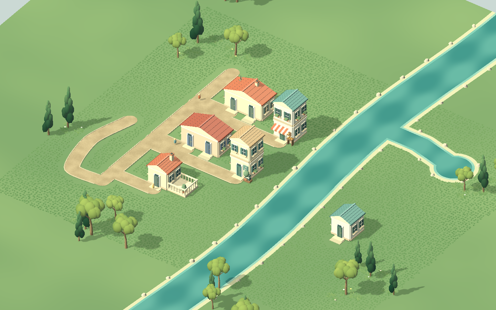

# 连续草地试验

2026-10-14。基于 Tiny Glade Grass2 的确定性实例/移除/风语义，以原创宽弯草叶覆盖整个编辑地块，0.26米世界采样，24块共享MultiMesh。树旁保留较高的林缘草花。

Godot4.7.2 / Compatibility / RTX5070Ti Laptop / 1440×900 / 五轨有声：约180FPS，p95 5.56ms；10699短草+304林缘实例。新曲路导致6草块重检/重建95.797ms，总108.839ms；见 [性能](after/performance.json)。`test_city_creation_nature_render.gd` PASS：6144点局部mask等价，远水保留15块，路口单面、桥180顶点高度和法线正确。

当前均匀叶团和矩形编辑边界仍突兀，草毯没有达到最终 Tiny Glade 观感；需要密度/远景消隐、自然边缘、分块预算进一步优化。只验证了运行与避让，不将技术PASS替代视觉接受。

复跑 `Godot --path . --script res://tools/check_creation_art.gd -- --grass-carpet`。Git基线 `backup/pre-grass-carpet-20261014`；修改前PROJECT/meadow保留 `备份/连续草地前_20261014/`。
