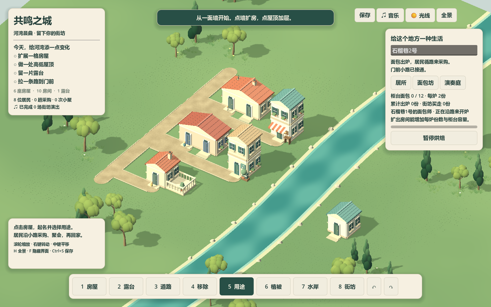
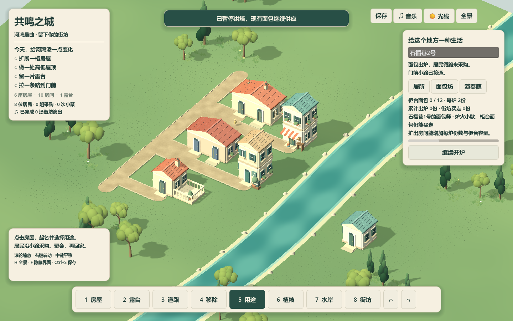
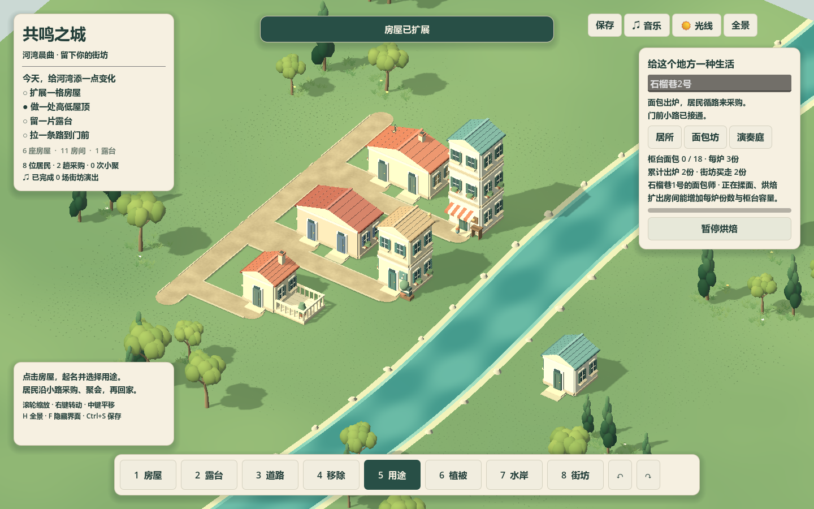

# 面包坊供给、实际采购与扩建 · 2026-10-14

面包师从真实可达住宅沿路到岗，完成6秒烘焙才出炉，三炉后沿路回家休息4秒再上班。每居所已有一名日常代表，第二位可承担一个工作岗位；每坊一位面包师、每居所最多一个岗位，稳定分配不因新建更近居所改人。

每个真实room提供每炉1份、柜台容量6份，露台不计。库存不够容纳完整新批次时停炉保留进度；暂停烘焙同样保进度，存量继续出售。居民真实到店、完成驻留且有面包才采购；空柜保留等待，可赴演出后回来。库存严格满足 `stock = produced - served`，消费和生活计数一次结算。实际出炉触发短铃声；不新增长期音轨，不以音乐决定供给。

参考 [Foundation生产与功能语义](../../参考资料/Foundation逆向成品-2026-10-13/outputs/foundation-game-systems/SEMANTIC_GUIDE.md) 的岗位/工作循环/产出/库存/需求拆分；6秒与按房格计量是本作调参。本轮没有复刻原版小麦→面粉→面包投入链，农业、原料与运输继续制作。

## 数据与恢复

schema1增加 `bakery_supply` 台账、房屋 `bakery_open` 和 `journey_checkpoint.bakery_workers`。旧档默认空库存/开炉，无追溯产出。台账包括stock/produced/served；编辑撤销保留已发生供给，撤销整栋新房时按已签发房屋ID休眠，同ID重做取回库存，不扣除或丢弃。

工人保存真实住宅/岗位、位置/朝向、阶段、恢复阶段、烘焙/休息进度和已完成炉数。回读按当前用途、路网、真实驻留位置恢复；伪造远端烘焙回退合法通勤，不虚发批次。断路保存暂停位置和进度，再接路继续。手动保存可紧接编辑发生，捕获前先同步工人，不写入失效岗位。结构校验给工人保留与日常居民相同的2米门前边界余量，实际路线另作语义校验。

## 验证

- 状态143项PASS：有限库存、原子消费、开炉开关、房格容量、旧档回读、字段/数量/守恒/ID拒绝、真实生活不被撤销、休眠库存与工人checkpoint。
- 工人/生活PASS：到岗前零生产、完整驻留才出炉、空柜零采购、真库存消费、开关/满柜保进度、扩建、节点保持、断路、正常/暂停行程恢复、三炉回家、原岗位恢复、缺货赴约、非法远端烘焙、编辑后立即保存。
- 原状态、街坊状态、公共演出合约PASS；更新旧生活/跨水测试的无库存购买假设，跨水检查实际工人与居民共享桥高。原完整viewport与生活回归PASS，真实采购9次/小聚7次。
- 实际OpenGL窗口PASS：选面包坊、实际按钮暂停/继续；暂停10秒不出炉，剩余烘焙出2份并被真实居民买走；短音实际播放；柜台显示实际库存代表；加层容量12→18、每炉2→3，不凭扩建制造库存；存档供给与工人进度回读一致。

本机Godot4.7.2 / Compatibility / RTX5070Ti Laptop / 1440×900 / 七条有声PCM与居民/工人。截图/存档工作结束后等待540帧，最后240帧delta p95 **5.56ms**、约 **180FPS**；开炉切换整合 **2.939 / 2.978ms**，加层 **12.617ms**。630绘制调用、431393三角；包含全部预设尾音与4短效果的绝对峰上界仍为0.487<1。数据只证明当前本机小河湾。









原始日志与数据：`bakery_state.log`、`bakery_life.log`、`water_life.log`、`play_regression.log`、`runtime.log`、`report.json`。实窗与回读夹具在初始化前关闭个人持久化，测试存档另用时间戳路径。

```powershell
& 'D:\GODOT\Godot_v4.7.2-stable_win64_console.exe' --path . --headless --script tests/test_city_creation_bakery_state.gd --quit-after 1800
& 'D:\GODOT\Godot_v4.7.2-stable_win64_console.exe' --path . --headless --script tests/test_city_creation_bakery_life.gd --quit-after 1800
& 'D:\GODOT\Godot_v4.7.2-stable_win64_console.exe' --path . --script tools/check_creation_bakery.gd --quit-after 1800
```

柜台至多显示三份代表，精确库存在面板；房路改变时真实净空不够可省略柜台，存量仍保留。烘焙进度不按离线时间补算，工人恢复从保存状态继续。完整原料/物流、更多公共服务、低配/大城表现、最终地景美术与空间声场未完成。基线 `backup/pre-bakery-supply-20261014`；旧静态陈列片段已移入 `废弃/面包坊供给_2026-10-14/`。
